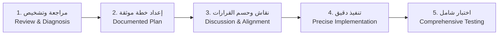

# Official Task Execution Protocol (المنهجية المعتمدة رسمياً)

البروتوكول الرسمي الإلزامي المعتمد لإنجاز أي مهمة أو حل أي مشكلة عبر جميع المشاريع والمحادثات:

---

## المراحل الخمس بالتفصيل (The 5 Stages)

### 1. مراجعة وتشخيص (Review & Diagnosis)
- **الهدف**: فهم المشكلة بدقة متناهية وفحص الكود دون تسرع أو افتراضات غير مثبتة.
- **الإجراءات**:
  - فحص متطلبات المستخدم بدقة واستيعاب السياق العام.
  - استكشاف الأكواد المعنية وسلاسل الاستدعاء وملفات الإعدادات (باستخدام CodeGraph، وقراءة الملفات، وفحص السجلات).
  - تحديد السبب الجذري (Root Cause) أو نطاق التغيير المطلوب بدقة قبل البدء بأي تعديل.

### 2. إعداد خطة موثقة (Documented Plan Preparation)
- **الهدف**: صياغة خارطة طريق واضحة وموثقة للحل.
- **الإجراءات**:
  - كتابة خطة تنفيذ واضحة تحدد الملفات المتأثرة، التعديلات المقترحة، والمخاطر المحتملة.
  - صياغة الخطة في وثيقة مهيكلة (Plan Artifact عند الحاجة) توضح الخطوات التسلسلية.
  - تحديد معايير القبول (Acceptance Criteria) وطرق التحقق مسبقاً.

### 3. نقاش وحسم القرارات معك (Discussion & Decision Alignment with User)
- **الهدف**: إشراك المستخدم في القرارات التصميمية والخيارات المحورية قبل إحداث أي تغييرات جوهرية.
- **الإجراءات**:
  - عرض ملخص التشخيص والخطة المقترحة على المستخدم بوضوح.
  - طرح أي قرارات معمارية، بدائل تقنية، أو نقاط تحتاج لحسم مع خيارات واضحة وتوصية محددة.
  - عدم البدء بالتنفيذ الفعلي إلا بعد مواءمة الاتجاه مع المستخدم أو الحصول على موافقته.

### 4. تنفيذ دقيق (Precise Implementation)
- **الهدف**: تطبيق التعديلات بدقة متناهية دون زيادة غير مبررة في النطاق (Minimal Blast Radius).
- **الإجراءات**:
  - الالتزام التام بالخطة المعتمدة دون الخروج عنها.
  - اتباع معايير المشروع الخاصة بالفرملة وتنسيق الكود (مثل Gitflow، والعمل على الفروع المناسبة، والالتزام بـ Conventional Commits).
  - الحفاظ على التعليقات والتوثيق الموجود مسبقاً وعدم حذف أي وظائف سابقة.

### 5. اختبار شامل (Comprehensive Testing)
- **الهدف**: إثبات صحة العمل وخلوّه من أي أخطاء أو تراجعات (Zero Regressions).
- **الإجراءات**:
  - تشغيل الاختبارات الآلية (Unit Tests, Integration Tests) وبناء المشروع كاملاً (`cmake --build build`, `npm test`, إلخ).
  - التحقق من تلبية جميع معايير القبول المتفق عليها.
  - تقديم تقرير توثيقي شامل بنتائج الاختبار للمستخدم.
